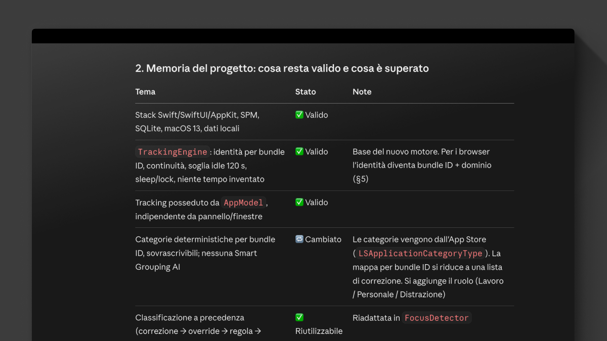
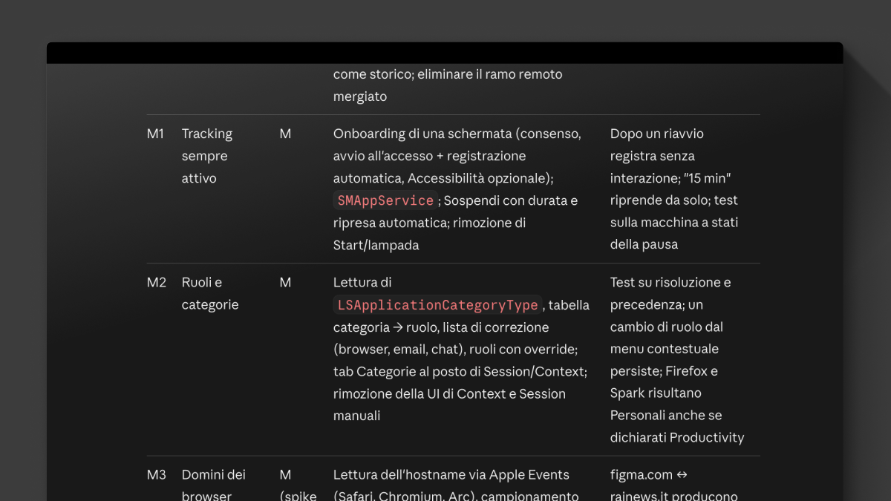
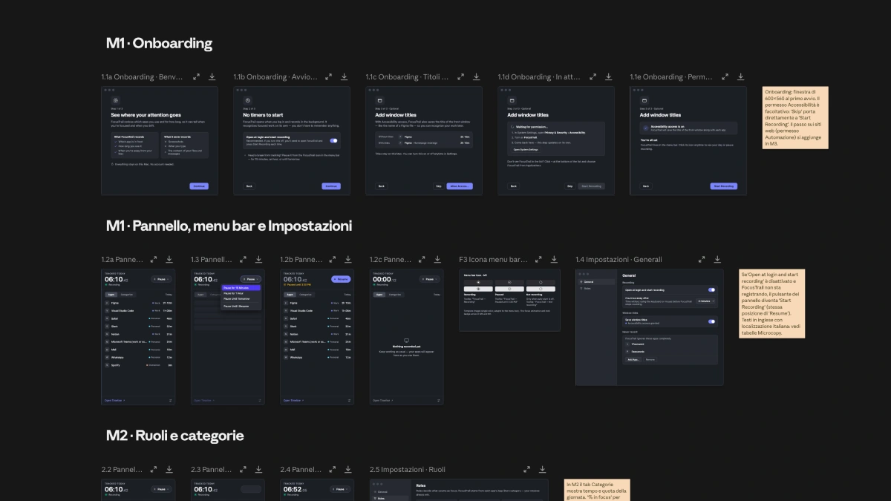

I'm designing and building a small macOS app with Claude. The app itself is useful to me, but that's not really why I'm doing it. It's mostly a playground to test a way of working.

And the first thing I learned is this: **managing the design of a product through a chat gets hard, very quickly.**

## The problem with one long chat

A chat is great for thinking. It's terrible for keeping track of decisions.

It happens to me all the time. I open a conversation to figure out how to set up the tests, and twenty messages later the AI is changing the color palette. Nobody asked for that. Or maybe I did, in passing, and it took me literally.

Now the palette decision lives inside a conversation about testing. Next week I won't remember where it is. I'll open a new chat, ask something related, and get an answer that ignores what we already decided.

Tasks overlap. Decisions get scattered across many conversations. Nothing is wrong in any single chat, but together they don't add up to a product.

If you've ever worked on a team without a backlog or a shared doc, you know this feeling. It's the same mess, just faster.

## The plan lives in a file

So I started with a plan, saved in the repository as `docs/PLAN.md`.

The plan has its own conversation. That's where I think out loud with the AI: what to do first, what can wait, what really matters for the first version, how long things should take. We argue a bit. I change my mind. The file gets updated.

It's a living conversation. I go back to it whenever something feels off and the plan needs adjusting. When we agree on a change, the file changes too.

The important part is that **the file is the source of truth, not the chat.** Any other conversation can read it and know where we are.

## Milestones, like always

Then the work gets split into milestones.

Nothing new here. If you've worked in an agile setup, you've done this a hundred times. Each milestone is a small, coherent chunk of the product that can be designed, built, and checked.

Milestones give each conversation a clear scope. When a chat has a boundary, it's much easier to notice when it drifts outside of it.

## Design milestones get their own conversation

**Each design milestone has its own conversation, and only that.
**
The first one is about design foundations: color, typography, spacing, the basic components, the tone of the interface. The output is a `DESIGN.md` file in the repo. It plays the same role as the plan, but for design decisions.

From there, every new design conversation starts from `DESIGN.md` and the plan. If a decision changes, it changes in the file. The palette doesn't get touched in a chat about tests anymore, because that chat has no reason to be talking about the palette.

## Development follows design

Development for a milestone starts as soon as its design is done. M1 design, then M1 development. Then M2 design, M2 development, and so on.

Development happens in Claude Code, inside the repository, where the plan and the design file are right there. Every feature gets its own pull request. One feature, one PR, one thing to review.

That's also how I keep the AI honest. **A PR is small enough **that I can actually read it and see if it respects what's in `DESIGN.md`.

## Nothing new, except the partner

**None of this is new to me**. Plans, milestones, separating design from development, small reviewable changes. I've followed and led this kind of process for years, with designers, developers, and product managers.

The only new thing is who sits on the other side of the table. Instead of a person, it's an AI.

And it turns out the **AI needs the same things people need**: clear scope, a shared place where decisions are written down, and someone who says "that's not what this meeting is about."

The structure isn't overhead. It's what makes the collaboration work.

I'll keep exploring this with the macOS app and share what I learn along the way.
