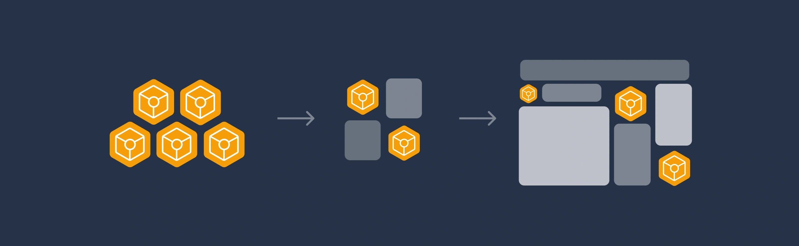
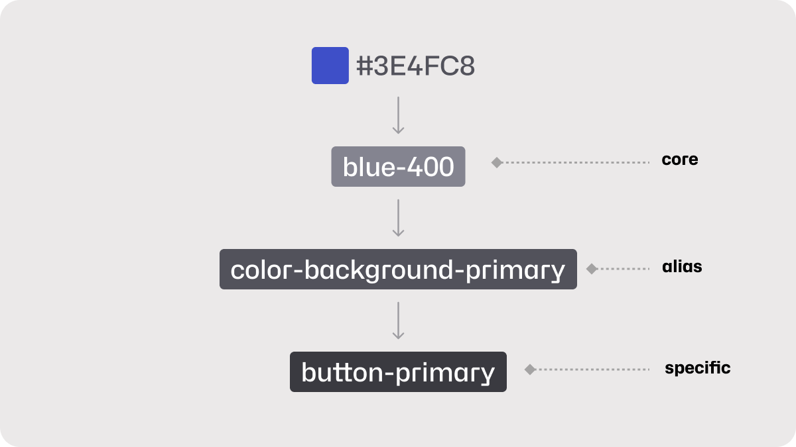
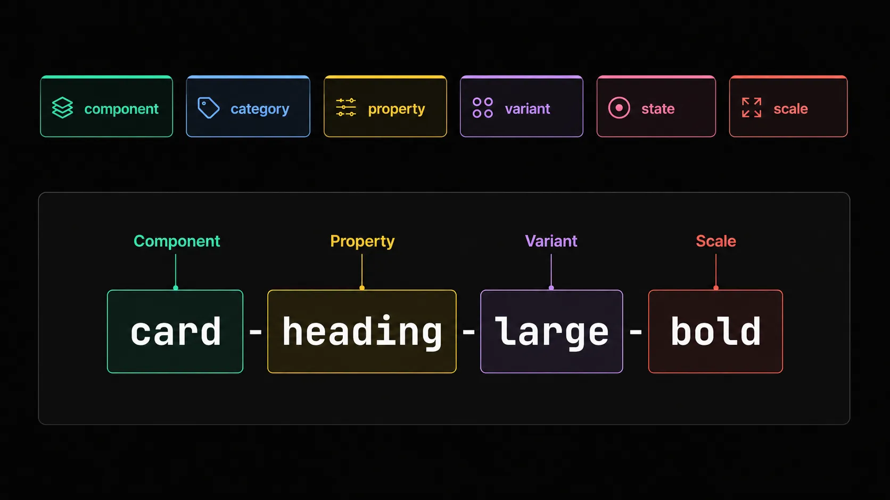
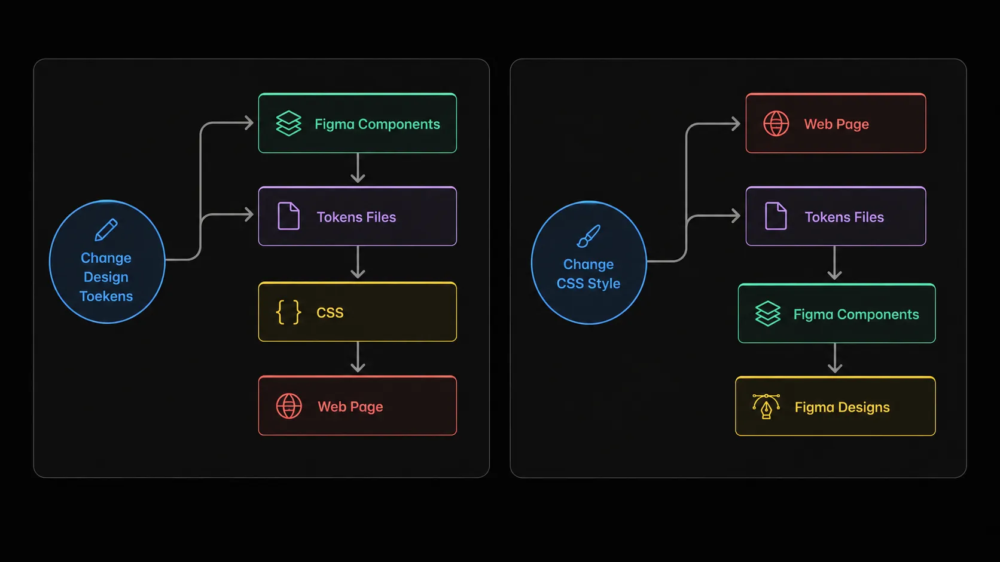
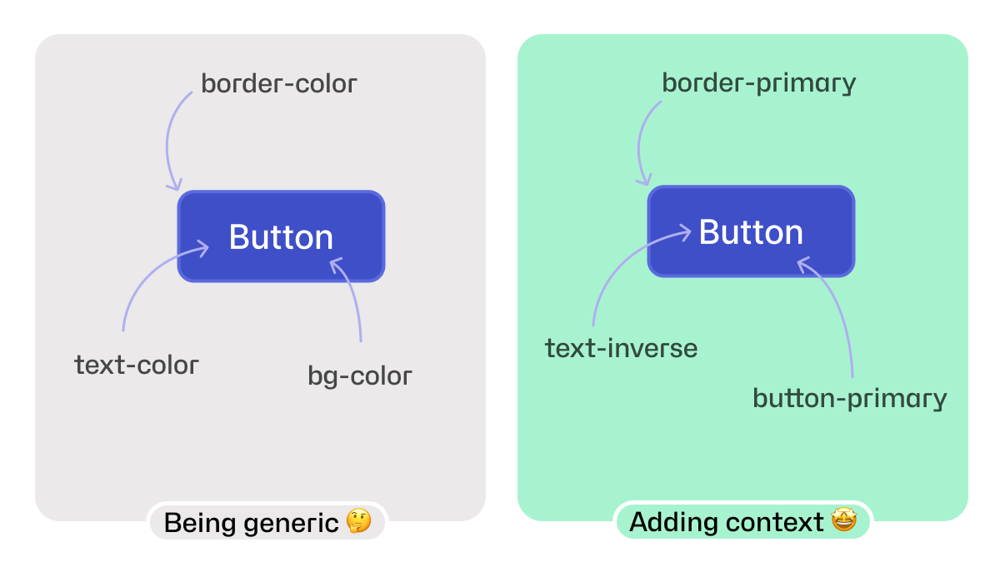

<!-- Token cards shared by the background artboard and the inline (mobile/tablet) placements -->

      

        
        
          color.accent.default
          hsl(38 98% 44%)
        
      



      

        tokens/space.json
<pre class="m-0 font-mono text-xs leading-relaxed">{
  "space": {
    "400": {
      "$type": "dimension",
      "$value": "16px"
    }
  }
}</pre>
      



      

        global
        amber.500
        ↓
        alias
        color.action.primary
        ↓
        component
        button.bg
      



      

        
          
          
          
          
        
        color.amber.100 → 500
      



      

        
        
          radius.lg
          24px
        
      



  <!-- Background design tokens (decorative) -->
  

    

      {{ tk_swatch }}
    

    

      {{ tk_json }}
    

    

      

        Aa
        font.size.display
        64px · 700
      

    

    

      

        space.1004px
        space.2008px
        space.40016px
        space.60024px
      

    

    

      {{ tk_chain }}
    

    

      {{ tk_palette }}
    

    

      {{ tk_radius }}
    

    

      

        <svg class="size-14 shrink-0" viewBox="0 0 64 64" fill="none"><rect x="1" y="1" width="62" height="62" rx="8" class="stroke-border"/><path d="M8 56C30 56 26 8 56 8" class="stroke-accent" stroke-width="2.5" stroke-linecap="round"/></svg>
        
          motion.fast
          150ms
        
      

    

    

      

        
        shadow.raised
      

    

    

      

        
        color.feedback.info
      

    

    

      

        tokens.css
<pre class="m-0 font-mono text-[11px] leading-relaxed">:root {
  --radius-lg: 24px;
  --space-400: 1rem;
}</pre>
      

    

    

      

        
        color.feedback.success
      

    

  

<!-- Hero Section -->
<section class="hero px-6 lg:px-10 pt-12 lg:pt-20 pb-12 lg:pb-16">
  

    

      Design Tokens · Workshop online
      <h1 class="font-heading text-4xl font-bold leading-[1.05] tracking-tight sm:text-5xl lg:text-6xl">Trasforma le decisioni di design in un sistema che scala</h1>
      

        

          {{ tk_swatch }}
        

      

      
In quattro mattine impari a definire, nominare e gestire i design tokens: dall’architettura a livelli alla naming convention, da Figma al JSON fino alle variabili CSS.

      

        
        Con <strong class="font-medium text-foreground">Francesco Improta</strong>, designer esperto in Design Systems e Product Design.
      

      

        <a href="#booking" class="inline-flex items-center justify-center bg-accent px-8 py-4 text-lg font-medium text-accent-foreground hover:opacity-90 rounded-full shadow-sm hover:shadow-lg hover:-translate-y-0.5 transition-all duration-300">Vedi date e prenota</a>
        <a href="#details" class="inline-flex items-center justify-center px-2 py-3 text-sm font-medium underline underline-offset-4 transition-opacity hover:opacity-70">Scopri il programma →</a>
        

          {{ tk_json }}
        

      

    

  

</section>

<!-- What to expect -->
<section class="px-6 py-12 lg:px-10 lg:py-16" id="expect">
  

    

      L’esperienza
      <h2 class="font-heading text-3xl font-bold leading-tight tracking-tight sm:text-4xl lg:text-5xl">Cosa aspettarti da questo workshop</h2>
    

    

      <article class="border-t border-border pt-5">
        01
        <h3 class="mt-1 font-heading text-lg font-medium">Quattro sessioni live</h3>
        
Quattro mattine da quattro ore, da remoto, con spazio per domande, confronto e feedback diretto.

      </article>
      <article class="border-t border-border pt-5">
        02
        <h3 class="mt-1 font-heading text-lg font-medium">Approccio hands-on</h3>
        
Lavori su un caso reale: dalla tassonomia fino ai file CSS generati con Style Dictionary.

      </article>
      <article class="border-t border-border pt-5">
        03
        <h3 class="mt-1 font-heading text-lg font-medium">Esercitazioni guidate</h3>
        
Crei una tassonomia, dai un nome ai token e li applichi in Figma e nel codice.

      </article>
      <article class="border-t border-border pt-5">
        04
        <h3 class="mt-1 font-heading text-lg font-medium">Gruppo ristretto</h3>
        
Massimo sei partecipanti per rendere il confronto utile e partecipato.

      </article>
      <article class="border-t border-border pt-5">
        05
        <h3 class="mt-1 font-heading text-lg font-medium">Accesso ai materiali</h3>
        
Ricevi le registrazioni, il materiale didattico e le risorse per continuare in autonomia.

      </article>
      <article class="border-t border-border pt-5">
        06
        <h3 class="mt-1 font-heading text-lg font-medium">Attestato di partecipazione</h3>
        
Ricevi un attestato digitale da inserire nel tuo profilo LinkedIn.

      </article>
    

  

</section>

<!-- Booking -->
<section class="scroll-mt-32 px-6 pt-28 pb-12 sm:pt-56 lg:scroll-mt-24 lg:px-10 lg:pb-16 xl:pt-16" id="booking">
  

    

      {{ tk_palette }}
    

    

      {{ tk_radius }}
    

    

      {{ tk_chain }}
    

    

      Partecipa
      <h2 class="font-heading text-3xl font-bold leading-tight tracking-tight sm:text-4xl lg:text-5xl">Riserva il tuo posto</h2>
      
Il tuo acquisto è valido per tutte le date disponibili.

    

    
  

</section>

<!-- Why design tokens -->
<section class="tokens-what px-6 lg:px-10 py-12 lg:py-16" id="what">
  

    

      

        Il metodo
        <h2 class="max-w-xl font-heading text-3xl font-bold leading-tight tracking-tight sm:text-4xl lg:text-5xl">Perché partire dai design tokens</h2>
        
Quando un prodotto cresce, colori, spaziature e tipografia si moltiplicano tra file di design e codice. I design tokens trasformano queste decisioni in una fonte unica, con nomi chiari, che designer e developer possono usare e far evolvere insieme.

      

      

        

          

            <svg xmlns="http://www.w3.org/2000/svg" width="20" height="20" viewBox="0 0 24 24" fill="none" stroke="currentColor" stroke-width="1.6" stroke-linecap="round" stroke-linejoin="round" class="shrink-0 text-accent" aria-hidden="true"><ellipse cx="12" cy="5" rx="9" ry="3"/><path d="M3 5v14a9 3 0 0 0 18 0V5"/><path d="M3 12a9 3 0 0 0 18 0"/></svg>
            <h3 class="font-heading text-base font-medium">Una sola fonte di verità</h3>
          

          
Ogni valore visivo vive in un solo posto e si propaga ovunque serva.

        

        

          

            <svg xmlns="http://www.w3.org/2000/svg" width="20" height="20" viewBox="0 0 24 24" fill="none" stroke="currentColor" stroke-width="1.6" stroke-linecap="round" stroke-linejoin="round" class="shrink-0 text-accent" aria-hidden="true"><circle cx="12" cy="12" r="9"/><path d="M12 3a9 9 0 0 0 0 18z" fill="currentColor"/></svg>
            <h3 class="font-heading text-base font-medium">Temi e dark mode</h3>
          

          
Cambi tema o brand intervenendo sui valori, non su ogni singolo componente.

        

        

          

            <svg xmlns="http://www.w3.org/2000/svg" width="20" height="20" viewBox="0 0 24 24" fill="none" stroke="currentColor" stroke-width="1.6" stroke-linecap="round" stroke-linejoin="round" class="shrink-0 text-accent" aria-hidden="true"><path d="M16 21v-2a4 4 0 0 0-4-4H6a4 4 0 0 0-4 4v2"/><path d="M16 3.128a4 4 0 0 1 0 7.744"/><path d="M22 21v-2a4 4 0 0 0-3-3.87"/><circle cx="9" cy="7" r="4"/></svg>
            <h3 class="font-heading text-base font-medium">Allinea design e codice</h3>
          

          
Figma e CSS usano gli stessi nomi: il team parla la stessa lingua.

        

        

          

            <svg xmlns="http://www.w3.org/2000/svg" width="20" height="20" viewBox="0 0 24 24" fill="none" stroke="currentColor" stroke-width="1.6" stroke-linecap="round" stroke-linejoin="round" class="shrink-0 text-accent" aria-hidden="true"><path d="M3 3v18h18"/><path d="m7 15 4-4 3 3 6-6"/></svg>
            <h3 class="font-heading text-base font-medium">Scala senza debito</h3>
          

          
Eviti valori hardcoded e varianti non documentate mentre il prodotto cresce.

        

      

    

    <figure class="tokens-what-media mt-12 lg:mt-16">
      
    </figure>
  

</section>

<!-- Audience Section -->
<section class="tokens-what-next scroll-mt-32 px-6 pb-12 lg:scroll-mt-24 lg:px-10 lg:pb-16" id="audience">
  

    

      Destinatari
      <h2 class="font-heading text-3xl font-bold leading-tight tracking-tight sm:text-4xl lg:text-5xl">Chi può partecipare?</h2>
    

    

      

        <h3 class="font-heading text-xl font-medium">Hai questo ruolo</h3>
        <ul class="mt-5 flex list-none flex-col gap-4 p-0 text-base leading-relaxed">
          <li class="flex gap-3 text-muted-foreground">¬Sei <strong class="text-primary">product, UI o design system designer</strong> e vuoi dare struttura ai fondamenti visivi.</li>
          <li class="flex gap-3 text-muted-foreground">¬Sei <strong class="text-primary">developer o design engineer</strong> e devi tradurre le decisioni di design in variabili e temi.</li>
          <li class="flex gap-3 text-muted-foreground">¬<strong class="text-primary">Coordini un team</strong> che sta costruendo o facendo evolvere un Design System.</li>
        </ul>
      

      

        <h3 class="font-heading text-xl font-medium">Hai questi problemi</h3>
        <ul class="mt-5 flex list-none flex-col gap-4 p-0 text-base leading-relaxed">
          <li class="flex gap-3 text-muted-foreground">¬Gli stessi valori sono <strong class="text-primary">duplicati e hardcoded</strong> tra Figma e codice.</li>
          <li class="flex gap-3 text-muted-foreground">¬Aggiungere <strong class="text-primary">un tema o la dark mode</strong> richiede interventi manuali ovunque.</li>
          <li class="flex gap-3 text-muted-foreground">¬Non sai <strong class="text-primary">come dare un nome</strong> ai token perché restino chiari nel tempo.</li>
        </ul>
      

    

  

</section>

<!-- Benefits Section: image first on mobile, alternating sides from md -->
<section class="scroll-mt-32 bg-card-foreground px-6 py-12 lg:scroll-mt-24 lg:px-10 lg:py-20" id="learn">
  

    

      Competenze
      <h2 class="font-heading text-3xl font-bold leading-tight tracking-tight sm:text-4xl lg:text-5xl">Cosa impari</h2>
    

    

      <article class="benefit-band flex flex-col items-center gap-8 md:flex-row-reverse lg:gap-16">
        

          
        

        

          <h3 class="mb-0 font-heading text-2xl font-semibold leading-tight lg:text-3xl">Definire un’architettura scalabile.</h3>
          
Organizzi i token in livelli (global, alias, component) con ruoli e responsabilità chiare.

        

      </article>
      <article class="benefit-band flex flex-col items-center gap-8 md:flex-row lg:gap-16">
        

          
        

        

          <h3 class="mb-0 font-heading text-2xl font-semibold leading-tight lg:text-3xl">Nominare i token in modo efficace.</h3>
          
Costruisci una tassonomia e una naming convention che restano chiare nel lungo periodo.

        

      </article>
      <article class="benefit-band flex flex-col items-center gap-8 md:flex-row-reverse lg:gap-16">
        

          
        

        

          <h3 class="mb-0 font-heading text-2xl font-semibold leading-tight lg:text-3xl">Gestire il ciclo di vita.</h3>
          
Da Figma al JSON alle variabili CSS, governi i token dalla definizione al rilascio.

        

      </article>
      <article class="benefit-band flex flex-col items-center gap-8 md:flex-row lg:gap-16">
        

          
        

        

          <h3 class="mb-0 font-heading text-2xl font-semibold leading-tight lg:text-3xl">Allineare il team.</h3>
          
Designer, developer e PM lavorano su una base condivisa e visibile del sistema.

        

      </article>
    

  

</section>

<!-- How the workshop works -->
<section class="scroll-mt-32 px-6 py-12 lg:scroll-mt-24 lg:px-10 lg:py-20" id="process" data-tokens-process>
  

    

      Metodo
      <h2 class="font-heading text-3xl font-bold leading-tight tracking-tight sm:text-4xl lg:text-5xl">Cosa fai, in pratica</h2>
      
Partendo da valori reali, strutturi i livelli, scegli i nomi e porti i token nel codice. Attività concrete che puoi applicare subito al tuo prodotto.

    

    

      

        <button class="w-[66.667vw] shrink-0 snap-center whitespace-normal lg:w-full lg:min-w-0 cursor-pointer rounded-2xl p-5 text-left text-muted-foreground transition-colors duration-200 hover:bg-gray-100 dark:hover:not-active:bg-secondary hover:text-foreground aria-selected:bg-secondary/70 aria-selected:text-foreground active:bg-accent/20 aria-selected:active:bg-accent/20 focus-visible:outline-2 focus-visible:outline-offset-2 focus-visible:outline-accent motion-reduce:transition-none" type="button" role="tab" id="process-tab-1" aria-controls="process-panel-1" aria-selected="true" tabindex="0" data-process-tab="1">
          01
          Strutturi i livelli
          Separi valori primitivi, decisioni semantiche e token di componente in un’architettura a livelli.
        </button>
        <button class="w-[66.667vw] shrink-0 snap-center whitespace-normal lg:w-full lg:min-w-0 cursor-pointer rounded-2xl p-5 text-left text-muted-foreground transition-colors duration-200 hover:bg-gray-100 dark:hover:not-active:bg-secondary hover:text-foreground aria-selected:bg-secondary/70 aria-selected:text-foreground active:bg-accent/20 aria-selected:active:bg-accent/20 focus-visible:outline-2 focus-visible:outline-offset-2 focus-visible:outline-accent motion-reduce:transition-none" type="button" role="tab" id="process-tab-2" aria-controls="process-panel-2" aria-selected="false" tabindex="-1" data-process-tab="2">
          02
          Scegli i nomi giusti
          Costruisci una tassonomia e scegli nomi che raccontano a cosa serve ogni valore.
        </button>
        <button class="w-[66.667vw] shrink-0 snap-center whitespace-normal lg:w-full lg:min-w-0 cursor-pointer rounded-2xl p-5 text-left text-muted-foreground transition-colors duration-200 hover:bg-gray-100 dark:hover:not-active:bg-secondary hover:text-foreground aria-selected:bg-secondary/70 aria-selected:text-foreground active:bg-accent/20 aria-selected:active:bg-accent/20 focus-visible:outline-2 focus-visible:outline-offset-2 focus-visible:outline-accent motion-reduce:transition-none" type="button" role="tab" id="process-tab-3" aria-controls="process-panel-3" aria-selected="false" tabindex="-1" data-process-tab="3">
          03
          Porti i token nel codice
          Esporti il JSON e generi variabili CSS, temi e dark mode con Style Dictionary.
        </button>
      

      

        

          

            

              Global
              amber.500
              gray.950
              size.400 · 16px
            

            

              Alias
              color.action.primary
              color.text.default
              space.inset.md
            

            

              Component
              button.bg.default
              button.label.color
              button.padding.x
            

          

        

        

          

            

              colorcategoria
              actionconcetto
              primaryvariante
              hoverstato
            

            
Ogni segmento risponde a una domanda: cosa è, a cosa serve, in quale variante e in quale stato. Il risultato è un nome leggibile da chi progetta e da chi sviluppa.

          

        

        

          

            

              tokens/color.json
<pre class="m-0 font-mono text-xs leading-relaxed">{
  "color": {
    "action": {
      "primary": {
        "$type": "color",
        "$value": "{amber.500}"
      }
    }
  }
}</pre>
            

            

              build/tokens.css
<pre class="m-0 font-mono text-xs leading-relaxed">:root {
  --amber-500: #de8e02;
  --color-action-primary:
    var(--amber-500);
}
[data-theme="dark"] {
  --color-action-primary:
    var(--amber-400);
}</pre>
            

          

        

      

    

  

</section>

<!-- Time and Schedule -->
<section class="scroll-mt-32 bg-secondary/40 px-6 py-12 lg:scroll-mt-24 lg:px-10 lg:py-20" id="schedule">
  

    

      

        Time &amp; Schedule
        <h2 class="font-heading text-3xl font-bold leading-tight tracking-tight sm:text-4xl lg:text-5xl">Quattro mattine di lavoro insieme</h2>
        
Il workshop si svolge online su Google Meet, in quattro giornate dalle <strong class="font-medium text-foreground">{{ page.offer.session_time }}</strong>. Alterniamo teoria essenziale, demo, esercitazioni e confronto finale.

      

      

        <dl class="grid grid-cols-1 gap-5 sm:grid-cols-2">
          

            <dt class="font-mono text-xs uppercase tracking-wide text-muted-foreground">Formato</dt>
            <dd class="mt-2 text-base font-medium">Online, dal vivo</dd>
          

          

            <dt class="font-mono text-xs uppercase tracking-wide text-muted-foreground">Durata</dt>
            <dd class="mt-2 text-base font-medium">4 giornate × 4 ore</dd>
          

          

            <dt class="font-mono text-xs uppercase tracking-wide text-muted-foreground">Partecipanti</dt>
            <dd class="mt-2 text-base font-medium">Massimo 6 persone</dd>
          

          

            <dt class="font-mono text-xs uppercase tracking-wide text-muted-foreground">Dopo il live</dt>
            <dd class="mt-2 text-base font-medium">Registrazioni e materiali</dd>
          

        </dl>
        <a href="#booking-final" class="mt-6 inline-flex text-sm font-medium underline underline-offset-4 transition-opacity hover:opacity-70">Vedi prezzo e prenota →</a>
      

    

  

</section>

<!-- Program Section -->

<svg class="shrink-0 text-accent" width="24" height="24" viewBox="0 0 24 24" fill="none" xmlns="http://www.w3.org/2000/svg" aria-hidden="true"><path d="M5 12h14" stroke="currentColor" stroke-width="2" stroke-linecap="round" /><path class="program-plus-vert" d="M12 5v14" stroke="currentColor" stroke-width="2" stroke-linecap="round" /></svg>

<section class="scroll-mt-32 lg:scroll-mt-24 px-6 lg:px-10 py-12 lg:py-16" id="details">
  

    <h2 class="font-heading text-3xl font-bold leading-tight tracking-tight sm:text-4xl lg:text-5xl mb-8">Il programma completo</h2>
    

      

        

          

            <h4 class="meta-tag mb-2">01 Fondamenti teorici</h4>
            <h3 class="font-heading text-xl font-medium">Fondamenti, evoluzione e valore dei design tokens</h3>
          

          {{ plus_icon }}
        

        

          <ul class="flex flex-col gap-2 m-0 p-0 list-none">
            <li class="meta-tag">Argomenti</li>
            <li class="text-base">¬ Definizione dei design tokens nei moderni sistemi di design</li>
            <li class="text-base">¬ Dai valori hardcoded ai design tokens: storia e contesto</li>
            <li class="text-base">¬ Differenze tra variabili CSS, variabili SASS, stili Figma e tokens</li>
          </ul>
        

      

      

        

          

            <h4 class="meta-tag mb-2">02 Architettura e organizzazione</h4>
            <h3 class="font-heading text-xl font-medium">Organizza i design tokens in un sistema scalabile</h3>
          

          {{ plus_icon }}
        

        

          <ul class="flex flex-col gap-2 m-0 p-0 list-none">
            <li class="meta-tag">Argomenti</li>
            <li class="text-base">¬ Architettura a livelli: global, alias e component tokens</li>
            <li class="text-base">¬ Design tokens systems: color, typography, spacing, icon</li>
            <li class="text-base">¬ Gestire la specificità</li>
            <li class="text-base">¬ Strategie di versionamento</li>
          </ul>
        

      

      

        

          

            <h4 class="meta-tag mb-2">03 Naming e tassonomia</h4>
            <h3 class="font-heading text-xl font-medium">Scegliere nomi significativi per i fondamenti visivi</h3>
          

          {{ plus_icon }}
        

        

          <ul class="flex flex-col gap-2 m-0 p-0 list-none">
            <li class="meta-tag">Argomenti</li>
            <li class="text-base">¬ Come costruire una tassonomia di vocaboli</li>
            <li class="text-base">¬ Le caratteristiche di un buon nome</li>
            <li class="text-base">¬ Creare nomi memorabili</li>
            <li class="text-base">¬ Convenzioni di scrittura</li>
            <li class="text-base">¬ Specifiche W3C e standard emergenti</li>
            <li class="text-base">¬ <strong class="font-medium text-foreground">Esercitazione:</strong> creare una tassonomia e dare un nome ai design tokens</li>
          </ul>
        

      

      

        

          

            <h4 class="meta-tag mb-2">04 I design tokens in Figma</h4>
            <h3 class="font-heading text-xl font-medium">Gestisci l’intero ciclo di vita dei design tokens</h3>
          

          {{ plus_icon }}
        

        

          <ul class="flex flex-col gap-2 m-0 p-0 list-none">
            <li class="meta-tag">Argomenti</li>
            <li class="text-base">¬ Flusso di lavoro completo: dalla definizione all’implementazione</li>
            <li class="text-base">¬ Usare i design tokens in Figma</li>
            <li class="text-base">¬ Demo: esportazione e gestione tramite Style Dictionary</li>
            <li class="text-base">¬ Strategie per la collaborazione designer-developer</li>
            <li class="text-base">¬ <strong class="font-medium text-foreground">Esercitazione:</strong> applicare i design tokens in Figma</li>
          </ul>
        

      

      

        

          

            <h4 class="meta-tag mb-2">05 I design tokens nel codice</h4>
            <h3 class="font-heading text-xl font-medium">Implementare i design tokens nei file CSS</h3>
          

          {{ plus_icon }}
        

        

          <ul class="flex flex-col gap-2 m-0 p-0 list-none">
            <li class="meta-tag">Argomenti</li>
            <li class="text-base">¬ Tecniche di trasformazione da JSON a CSS tramite Style Dictionary</li>
            <li class="text-base">¬ Media queries e tokens: gestione responsive</li>
            <li class="text-base">¬ Gestire temi e dark mode con i design tokens e CSS</li>
            <li class="text-base">¬ <strong class="font-medium text-foreground">Esercitazione:</strong> trasformare i design tokens in variabili CSS</li>
          </ul>
        

      

      

        

          

            <h4 class="meta-tag mb-2">06 Governance e documentazione</h4>
            <h3 class="font-heading text-xl font-medium">Pianifica e gestisci i design tokens nel tempo</h3>
          

          {{ plus_icon }}
        

        

          <ul class="flex flex-col gap-2 m-0 p-0 list-none">
            <li class="meta-tag">Argomenti</li>
            <li class="text-base">¬ Modello di governance: chi fa cosa</li>
            <li class="text-base">¬ Gestire aggiornamenti e rilasci</li>
            <li class="text-base">¬ Versionamento semantico</li>
            <li class="text-base">¬ Documentare i design tokens</li>
          </ul>
        

      

    

    

      

      <h4 class="font-heading text-xl font-semibold mb-6">Materiali inclusi</h4>
      <ul class="grid grid-cols-1 md:grid-cols-2 gap-3 m-0 p-0 list-none">
        <li class="flex items-center text-base font-medium">
          <svg xmlns="http://www.w3.org/2000/svg" width="24" height="24" viewBox="0 0 24 24" fill="none" stroke="currentColor" stroke-width="1.5" stroke-linecap="round" stroke-linejoin="round" class="text-accent mr-2" aria-hidden="true"><rect width="8" height="18" x="3" y="3" rx="1"/><path d="M7 3v18"/><path d="M20.4 18.9c.2.5-.1 1.1-.6 1.3l-1.9.7c-.5.2-1.1-.1-1.3-.6L11.1 5.1c-.2-.5.1-1.1.6-1.3l1.9-.7c.5-.2 1.1.1 1.3.6Z"/></svg>&nbsp;Materiale didattico e risorse scaricabili
        </li>
        <li class="flex items-center text-base font-medium">
          <svg xmlns="http://www.w3.org/2000/svg" width="24" height="24" viewBox="0 0 24 24" fill="none" stroke="currentColor" stroke-width="1.5" stroke-linecap="round" stroke-linejoin="round" class="text-accent mr-2" aria-hidden="true"><path d="m16 13 5.223 3.482a.5.5 0 0 0 .777-.416V7.87a.5.5 0 0 0-.752-.432L16 10.5"/><rect x="2" y="6" width="14" height="12" rx="2"/></svg>&nbsp;Registrazioni delle lezioni
        </li>
        <li class="flex items-center text-base font-medium">
          <svg xmlns="http://www.w3.org/2000/svg" width="24" height="24" viewBox="0 0 24 24" fill="none" stroke="currentColor" stroke-width="1.5" stroke-linecap="round" stroke-linejoin="round" class="text-accent mr-2" aria-hidden="true"><path d="M7.9 20A9 9 0 1 0 4 16.1L2 22Z"/></svg>&nbsp;Supporto post workshop
        </li>
        <li class="flex items-center text-base font-medium">
          <svg xmlns="http://www.w3.org/2000/svg" width="24" height="24" viewBox="0 0 24 24" fill="none" stroke="currentColor" stroke-width="1.5" stroke-linecap="round" stroke-linejoin="round" class="text-accent mr-2" aria-hidden="true"><path d="m15.477 12.89 1.515 8.526a.5.5 0 0 1-.81.47l-3.58-2.687a1 1 0 0 0-1.197 0l-3.586 2.686a.5.5 0 0 1-.81-.469l1.514-8.526"/><circle cx="12" cy="8" r="6"/></svg>&nbsp;Attestato di partecipazione
        </li>
      </ul>
    

  

</section>

<!-- Instructor Section -->
<section class="scroll-mt-32 lg:scroll-mt-24 px-6 lg:px-10 py-12 lg:py-16" id="teacher">
  

    

      Chi sono
      <h2 class="font-heading text-3xl font-bold leading-tight tracking-tight sm:text-4xl lg:text-5xl mb-8">Porto nel workshop oltre 20 anni di esperienza sui prodotti digitali</h2>
      
    

    

      
👋 Ciao, sono <strong class="font-semibold">Francesco Improta</strong>, designer con oltre 20 anni di esperienza nel design di prodotti digitali, specializzato in Design System.

      
Ho creato questo workshop per <strong class="font-medium text-foreground">aiutarti a comprendere i design tokens e ad applicarli in modo efficace</strong>, riducendo i tempi di sviluppo e migliorando la coerenza del prodotto.

      
Durante il workshop <strong class="font-medium text-foreground">condividerò esperienze pratiche e strumenti</strong> che ho utilizzato in anni di lavoro su progetti complessi.

      

        <a href="/about" class="text-sm underline text-muted-foreground underline-offset-2 hover:opacity-70 transition-opacity">Qualcosa su di me →</a>
      

    

  

</section>

<!-- Testimonials Section -->
<section class="scroll-mt-32 lg:scroll-mt-24 bg-secondary/40 px-6 lg:px-10 py-12 lg:py-16" id="testimonials">
  

    Testimonianze
    <h2 class="font-heading text-3xl font-bold leading-tight tracking-tight sm:text-4xl lg:text-5xl mb-12">Cosa dicono i partecipanti</h2>
    
    

  

</section>

<!-- FAQ Section -->

<svg class="shrink-0 text-accent transition-transform duration-200 group-open:rotate-180" width="24" height="24" viewBox="0 0 24 24" fill="none" xmlns="http://www.w3.org/2000/svg" aria-hidden="true"><path d="M6 9L12 15L18 9" stroke="currentColor" stroke-width="2" stroke-linecap="round" stroke-linejoin="round"/></svg>

<section class="scroll-mt-32 lg:scroll-mt-24 px-6 lg:px-10 py-12 lg:py-16" id="faq">
  

    Domande frequenti
    <h2 class="font-heading text-3xl font-bold leading-tight tracking-tight sm:text-4xl lg:text-5xl mb-3">Questo corso è per me?</h2>
    
Tutto quello che serve sapere prima di prenotare il workshop.

    

      

        

          <h4 class="m-0 text-lg font-medium underline underline-offset-2">Come funziona il workshop?</h4>
          {{ chevron_icon }}
        

        
Il workshop si svolge online via Google Meet, con sessioni pratiche e teoria. Riceverai un link per accedere una settimana prima della data prevista.

      

      

        

          <h4 class="m-0 text-lg font-medium underline underline-offset-2">Devo avere esperienza con i design tokens?</h4>
          {{ chevron_icon }}
        

        
No, il workshop parte dalle basi. Ti fornirò io tutti gli strumenti teorici e pratici per mettere in pratica quanto appreso.

      

      

        

          <h4 class="m-0 text-lg font-medium underline underline-offset-2">L'acquisto del corso è per una data specifica?</h4>
          {{ chevron_icon }}
        

        
No, il tuo acquisto è valido per tutte le date disponibili. Se non puoi partecipare alla data pubblicata, potrai farlo in una delle successive. In genere annuncio le date un mese prima.

      

      

        

          <h4 class="m-0 text-lg font-medium underline underline-offset-2">Posso partecipare anche se non sono un designer?</h4>
          {{ chevron_icon }}
        

        
Assolutamente sì! Il workshop è utile per tutti coloro i quali vogliono approfondire la conoscenza dei design tokens, indipendentemente dal proprio ruolo in un team.

      

      

        

          <h4 class="m-0 text-lg font-medium underline underline-offset-2">Cosa succede se acquisto il corso ma non posso partecipare?</h4>
          {{ chevron_icon }}
        

        
Nessun problema, il tuo acquisto sarà valido per una delle date successive, a meno che non ci ripensi. In quel caso ti sarà inviato un rimborso.

      

      

        

          <h4 class="m-0 text-lg font-medium underline underline-offset-2">Posso pagare il corso a rate?</h4>
          {{ chevron_icon }}
        

        
Sì, supporto Paypal e Klarna come metodi di pagamento che ti consentono di suddividere l'importo in piani a rate, secondo le rispettive modalità.

      

      

        

          <h4 class="m-0 text-lg font-medium underline underline-offset-2">Ho bisogno di strumenti specifici?</h4>
          {{ chevron_icon }}
        

        
No, basta un computer e una connessione internet. Ti fornirò tutto il materiale necessario.

      

      

        

          <h4 class="m-0 text-lg font-medium underline underline-offset-2">È possibile organizzare un workshop per più di 6 persone?</h4>
          {{ chevron_icon }}
        

        
Per workshop aziendali personalizzati puoi contattarmi a me[at]francescoimprota.com.

      

    

  

</section>

<!-- Final CTA Section -->
<section class="scroll-mt-32 lg:scroll-mt-24 bg-card-foreground px-6 lg:px-10 py-16 lg:py-20" id="booking-final">
  

    <h2 class="font-heading text-3xl font-bold leading-tight tracking-tight sm:text-4xl lg:text-5xl mb-3">Crea design tokens efficaci</h2>
    
Riserva il tuo posto in una delle date disponibili.

    

      
    

    

    
Hai dubbi o altre domande?

    

      <a href="https://cal.com/francesco-improta/30min" class="inline-flex items-center justify-center gap-2 text-lg underline underline-offset-2 hover:opacity-70 transition-opacity"><svg xmlns="http://www.w3.org/2000/svg" width="20" height="20" viewBox="0 0 24 24" fill="none" stroke="currentColor" stroke-width="1.5" stroke-linecap="round" stroke-linejoin="round" class="text-accent" aria-hidden="true"><path d="M21 7.5V6a2 2 0 0 0-2-2H5a2 2 0 0 0-2 2v14a2 2 0 0 0 2 2h3.5"/><path d="M16 2v4"/><path d="M8 2v4"/><path d="M3 10h5"/><path d="M17.5 17.5 16 16.3V14"/><circle cx="16" cy="16" r="6"/></svg>Parliamone insieme</a>
    

  

</section>

